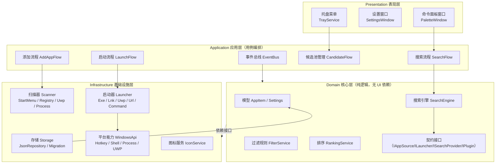

# 轻启（QuickPalette）快捷启动器 · 详细设计方案

> 版本：v1.0
> 日期：2026-09-28
> 状态：评审稿
> 定位：基于 DeepSeek 生成的《个人快捷启动器整体方案》深化设计，重点强化**长期使用的稳定性**与**后期开发的可拓展性**。

---

## 目录

1. [项目背景与痛点](#1-项目背景与痛点)
2. [产品定位与设计原则](#2-产品定位与设计原则)
3. [核心交互流程](#3-核心交互流程)
4. [功能规划与路线图](#4-功能规划与路线图)
5. [应用发现与过滤策略](#5-应用发现与过滤策略)
6. [搜索与排序设计](#6-搜索与排序设计)
7. [数据模型与存储设计（面向长期使用）](#7-数据模型与存储设计面向长期使用)
8. [技术架构（面向可拓展）](#8-技术架构面向可拓展)
9. [技术选型](#9-技术选型)
10. [长期使用保障设计](#10-长期使用保障设计)
11. [可拓展性设计详解](#11-可拓展性设计详解)
12. [开发计划与里程碑](#12-开发计划与里程碑)
13. [质量保障与测试](#13-质量保障与测试)
14. [风险与应对](#14-风险与应对)
15. [AI Coding 实施指引](#15-ai-coding-实施指引)
16. [验收 Checklist](#16-验收-checklist)

---

## 1. 项目背景与痛点

### 1.1 场景描述

用户为了保持桌面整洁，会删除不常用软件的桌面快捷方式。需要使用时改为从**开始菜单**查找，但发现部分软件**根本没有注册开始菜单快捷方式**；若自行编写软件扫描已安装应用，则结果**过于杂乱**（混入大量系统自带程序、各软件的卸载程序等）。

### 1.2 痛点拆解

| 痛点 | 本质 |
| --- | --- |
| 桌面快捷方式被删除后无处快速启动 | 缺少一个**用户自己维护**的、稳定的启动入口 |
| 开始菜单未必有快捷方式 | 依赖系统注册情况，不可控 |
| 全量扫描结果太杂 | 缺少**用户确认机制**和**智能过滤** |

### 1.3 关键结论

本方案的核心判断是：**不要做"已安装软件扫描器"，要做"个人白名单快捷启动器"**。系统无法替你判断"哪些软件常用"，因此必须把选择权完全交给用户，自动发现只作为辅助输入。

---

## 2. 产品定位与设计原则

### 2.1 一句话定位

> 一个 Windows 本地、托盘常驻、全局热键唤起的**个人白名单命令面板**：自动扫描只负责提供候选，用户勾选后才进入主列表；支持拖拽 exe、运行中捕获、拼音别名搜索、回车启动。

### 2.2 核心设计原则

1. **白名单模式**：只有用户添加/确认的应用才出现在主列表，杜绝杂乱。
2. **自动发现只进候选池**：开始菜单、注册表、运行中进程扫描到的应用，默认不直接进入主列表，由用户确认。
3. **默认隐藏系统组件与卸载项**：`uninstall`、`update`、`helper`、`crash`、`report`、`setup`、`readme` 等一律过滤。
4. **添加要极简**：拖拽、运行中捕获、开始菜单导入，最多 1–3 步。
5. **使用要极简**：热键唤起 → 输入名称/拼音/别名 → 回车启动，全程键盘可完成。
6. **本地优先**：数据存储在本机，无账号、无云依赖，长期使用不依赖任何外部服务。
7. **契约先行、可插拔**：核心逻辑面向接口编程，为后期插件、新数据源、新平台预留扩展点。

### 2.3 目标用户与使用场景

- 注重桌面整洁、习惯键盘操作、装机软件较多的 Windows 用户。
- 场景一：日常高频启动（微信、VS Code、浏览器等）——收藏 + 热键秒开。
- 场景二：低频软件（可能没有开始菜单快捷方式）——拖拽或运行中捕获一次加入，永久可用。
- 场景三：管理员工具、命令行、UWP 应用——统一入口，无需记忆路径。

### 2.4 产品形态

- 形态：Windows 桌面小工具，单进程常驻托盘。
- 主界面：无边框命令面板窗口（类似 Spotlight / PowerToys Run）。
- 交互：全局热键唤起/隐藏，失焦自动隐藏。

---

## 3. 核心交互流程

### 3.1 首次使用引导（First-Run）

```
首次启动
   │
   ├─ 1. 自动扫描：开始菜单 .lnk、App Paths 注册表、UWP 应用
   ├─ 2. 生成候选池：自动隐藏系统组件 / 卸载项 / 明显噪音
   ├─ 3. 展示"候选确认页"：按推荐度排序，勾选常用应用
   ├─ 4. 一键导入：可整体导入开始菜单中未被过滤的快捷方式
   └─ 5. 进入主界面：收藏默认置顶，可立即使用
```

设计要点：**首次扫描结果只进候选池，绝不静默加入主列表**。用户勾选后写入白名单，这一机制从根源上解决"太杂"问题。

### 3.2 添加应用（四种低摩擦方式）

| 方式 | 操作步骤 | 适用场景 |
| --- | --- | --- |
| **拖拽添加** | 将 `.exe` / `.lnk` 拖入命令面板 → 自动解析名称/图标/路径 → 回车保存 | 绿色软件、任意 exe，最快路径 |
| **运行中捕获** | 先手动打开该软件 → 在轻启中执行"捕获当前前台窗口进程" → 确认保存 | **没有开始菜单快捷方式的软件**（核心亮点） |
| **浏览添加** | 手动选择 exe → 可选填别名/参数/管理员运行 | 精细配置 |
| **候选导入** | 在候选池搜索并勾选 | 批量收录常用软件 |

> **针对痛点验证**：对于"开始菜单没有注册快捷方式"的软件，运行中捕获 + 拖拽添加两种方式完全不依赖系统注册信息，一次加入、永久可用。

### 3.3 日常使用

```
按全局热键（默认 Ctrl+Alt+Space，可自定义）
   → 输入："微信" / "wx" / "weixin" / 标签 / 别名
   → 上下键选择（结果 8–10 条）
   → Enter 启动
   → Shift+Enter 管理员启动
   → Ctrl+Enter 打开所在目录
   → 窗口失焦自动隐藏
```

空输入时展示：**收藏 + 最近使用**，无需输入即可一键直达。

### 3.4 应用管理

- 右键菜单：管理员运行 / 打开所在目录 / 编辑 / 收藏 / 隐藏 / 删除。
- 编辑页：名称、别名、标签、路径、参数、工作目录、图标、管理员运行、启用开关。
- "隐藏"与"删除"分离：隐藏 = 不再出现在任何列表（含候选池，防复活）；删除 = 彻底移除记录。

---

## 4. 功能规划与路线图

### 4.1 分期路线总览

| 版本 | 主题 | 核心内容 |
| --- | --- | --- |
| **V1 (MVP)** | 可用 | 命令面板、全局热键、托盘、搜索启动、手动/拖拽添加、开始菜单导入、收藏/隐藏、JSON 持久化、管理员启动 |
| **V2** | 好用 | 运行中捕获、UWP 应用、使用频率排序、标签/分组、导入导出、自动备份、开机启动、设置完善 |
| **V3** | 可拓展 | 插件系统、工作流（一键多启）、主题系统、便携模式、可选云同步/遥测、多语言 |
| **V4（远期）** | 智能 | AI 语义搜索、语音唤起、跨平台（架构已预留） |

### 4.2 V1 MVP 验收定义（必须全部达成才视为完成）

- 全局热键唤起/隐藏，窗口 200ms 内出现。
- 输入两个字母可定位常用应用。
- 添加一个软件不超过 3 步。
- 系统自带程序、卸载程序默认不出现。
- 无开始菜单快捷方式的软件，可通过拖拽或运行中捕获加入。
- 配置重启后不丢失。

### 4.3 明确不做（范围边界）

- 不做全盘 exe 扫描（违背"不杂"初衷，候选池已覆盖需求）。
  > 说明（实现更新）：候选池之外，实现里另有一个**可选的文件搜索子系统**（FileIndexWorker 读 NTFS USN 变更日志建文件名索引，默认可关），用于搜文档/文件而非"发现可执行程序"，不改变候选池边界。详见 [docs/实现现状与偏差说明.md](docs/实现现状与偏差说明.md)。
- 不做云同步/账号体系（V1–V2 阶段）。
- 不做复杂插件市场（V3 预留机制，不预先实现生态）。
- 不做应用商店、卸载管理、系统优化等越界功能。

---

## 5. 应用发现与过滤策略

### 5.1 候选来源（Source 抽象）

| 来源 | 说明 | 接口对应 |
| --- | --- | --- |
| 开始菜单 | 用户级 + 全局级 `.lnk` 快捷方式 | `IAppSource` |
| App Paths 注册表 | `HKLM/HKCU\Software\Microsoft\Windows\CurrentVersion\App Paths` | `IAppSource` |
| UWP / Store 应用 | 通过 `shell:AppsFolder` 或 AUMID 枚举 | `IAppSource` |
| 运行中进程 | 前台窗口进程路径（捕获模式） | `IAppSource` |
| 用户手动 | 拖拽 / 浏览 / 输入 | 白名单直接写入 |

### 5.2 默认过滤规则（FilterService）

**名称关键词黑名单**：

```
uninstall / 卸载 / modify / repair / update / updater / setup / install
helper / crash / report / telemetry / readme / documentation / service / daemon
```

**路径黑名单**：

```
C:\Windows\System32 / SysWOW64 / WinSxS / Microsoft.NET
WindowsApps 中的明显系统项（如 Settings、FeedbackHub 等，保留用户 UWP 白名单能力）
```

**行为规则**：

- 卸载程序（Uninstall 项）**只用于定位安装目录**，不直接展示为可启动应用。
- 无图标、无窗口、控制台型后台程序默认折叠到"更多"分组。
- 过滤规则全部**可配置**：用户可加白、加黑，可关闭某条规则。

### 5.3 去重策略

- 按目标 exe 路径、AUMID、规范化名称三重去重。
- 同一软件存在多个快捷方式时，保留"最合理"的一个（优先用户级 > 全局级 > 桌面，优先非卸载目录）。
- 去重结果写入 `candidates.json`，避免每次扫描重复出现。

### 5.4 用户可控性

- 候选池支持：勾选加入 / 全部隐藏此类 / 标记"不再推荐"。
- "隐藏记录"独立存储（`hidden.json`），以规范化键（路径/AUMID/名称小写）为键，防止清理工具后"复活"。

---

## 6. 搜索与排序设计

### 6.1 匹配维度（SearchProvider 抽象）

| 优先级 | 维度 | 说明 |
| --- | --- | --- |
| 1 | 名称精确匹配 | 完全一致 |
| 2 | 名称前缀匹配 | 以输入开头 |
| 3 | 名称子串匹配 | 包含输入 |
| 4 | 拼音全拼 / 首字母 | `weixin` / `wx` |
| 5 | 别名 / 标签匹配 | 用户自定义 |

### 6.2 排序算法（加权公式，可调）

```
最终分 = 匹配分 × 匹配权重
       + 收藏加分（favorite ? +100 : 0）
       + 使用频率加分（launchCount × 2）
       + 最近使用加分（距 lastLaunched 越近越高，指数衰减）
       + 手动排序权重（sortWeight，可选）
```

结果只显示 **8–10 条**，避免视觉噪音。

### 6.3 交互细节

- 空输入：展示"收藏 + 最近使用"。
- 全键盘操作：`↑/↓` 选择，`Enter` 启动，`Shift+Enter` 管理员，`Ctrl+Enter` 打开目录，`Esc` 隐藏。
- 支持命令模式（V2）：输入 `>` 触发内部命令（如 `>settings`、`>capture`、`>refresh`），为插件命令预留语法空间。

---

## 7. 数据模型与存储设计（面向长期使用）

> 长期使用意味着：数据跨版本不丢失、可备份、可迁移、可恢复。因此存储设计遵循 **Schema 版本化 + 原子写入 + 自动备份** 三条铁律。

### 7.1 核心实体：AppItem

```json
{
  "id": "a3f9...uuid",
  "name": "微信",
  "displayName": "WeChat",
  "aliases": ["wx", "wechat"],
  "pinyin": "weixin",
  "pinyinInitials": "wx",
  "type": "exe",
  "path": "C:\\Program Files\\Tencent\\WeChat\\WeChat.exe",
  "args": "",
  "workdir": "",
  "aumid": "",
  "iconPath": "icons/wechat.png",
  "source": "manual",
  "tags": ["社交"],
  "favorite": true,
  "launchCount": 12,
  "lastLaunched": "2026-09-28T10:00:00",
  "runAsAdmin": false,
  "enabled": true,
  "sortWeight": 0,
  "customFields": {},
  "createdAt": "2026-09-28T09:00:00",
  "updatedAt": "2026-09-28T10:00:00",
  "schemaVersion": 1
}
```

字段说明：

| 字段 | 类型 | 说明 |
| --- | --- | --- |
| id | string | UUID，跨设备导入的唯一标识 |
| type | enum | `exe` / `lnk` / `uwp` / `url` / `folder` / `command` |
| aumid | string | type=uwp 时的应用用户模型 ID |
| source | enum | `manual` / `startmenu` / `registry` / `process` / `uwp` / `import` |
| customFields | object | **扩展字段**：插件可写入任意业务数据，主程序不感知 |
| schemaVersion | int | 写入时记录的版本号，**迁移引擎据此升级** |

### 7.2 Settings 模型（分层配置）

| 配置项 | 默认值 | 说明 |
| --- | --- | --- |
| hotkey | `Ctrl+Alt+Space` | 可自定义，冲突时提示 |
| autoStart | false | 开机自启 |
| theme | `system` | 深色/浅色/跟随系统 |
| maxResults | 10 | 结果条数 |
| scanSources | 全开 | 启用的候选来源 |
| filterKeywords / filterPaths | 内置清单 | 过滤规则，可增删 |
| autoCaptureEnabled | true | 允许运行中捕获 |
| backupIntervalDays | 7 | 自动备份周期 |
| telemetryEnabled | false | 匿名统计，默认关闭 |
| locale | `zh-CN` | 语言 |

### 7.3 存储方案与目录结构

```
%APPDATA%\QuickPalette\
├── apps.json          # 主列表（白名单）——用户核心资产
├── settings.json      # 配置
├── candidates.json    # 候选池（可重建）
├── hidden.json        # 隐藏记录（防复活）
├── usage.json         # 使用频率/最近使用（可重建）
├── backups\           # 自动备份（滚动保留最近 10 份）
├── icons\             # 图标缓存（可按 id 清理）
├── logs\              # 滚动日志
└── plugins\           # V3 插件目录（预留）
```

> 为什么不用数据库：应用数量级（几十～几百条）下 JSON 足够，且**纯文本可读、可手改、可 diff、可 git 管理**，对长期维护更友好。仅当数据量增长（如历史统计）后再考虑 SQLite。

### 7.4 Schema 版本管理与数据迁移（长期使用关键）

- 每个数据文件带 `schemaVersion`。
- 提供 `IMigration` 迁移链：启动时按版本号顺序执行迁移（`v1 → v2 → ...`），迁移脚本幂等、可回滚（迁移前自动备份）。
- 规则：**禁止原地修改旧文件格式**；新字段必须带默认值；删除字段走"标记废弃"而非物理删除（兼容旧插件）。

### 7.5 备份与恢复

- **自动备份**：每次写入主文件前，自动复制旧文件到 `backups\`；周期备份由配置控制。
- **手动导出/导入**：导出为单个 `quickpalette-backup.json`（含 apps + settings + 版本号），支持一键恢复。
- **损坏自愈**：启动时校验 JSON 合法性；损坏时自动回滚最近备份，并在日志中记录（绝不静默丢失数据）。
- **便携模式（V3）**：`config` 目录可选放程序旁，支持 U 盘携带。

### 7.6 数据一致性

- 原子写入：写临时文件 → fsync → 原子替换，避免断电/崩溃损坏。
- 并发保护：单实例锁（命名 Mutex），防止双开互相覆盖。

---

## 8. 技术架构（面向可拓展）

### 8.1 总体架构（分层 + 依赖倒置）



**依赖规则（单向）**：表现层 → 应用层 → 核心层 →（依赖接口）→ 基础设施层。核心层**不引用任何 UI 或 Windows API 具体类型**，这是可测试与可拓展的前提。

### 8.2 各层职责

| 层 | 职责 | 关键约束 |
| --- | --- | --- |
| Presentation | 窗口、渲染、输入、托盘 UI | 不写业务逻辑 |
| Application | 编排用例、事件发布、工作流 | 薄层，只做协调 |
| Domain | 模型、搜索、过滤、排序、契约 | **零外部依赖**，可 100% 单元测试 |
| Infrastructure | Windows API、存储、扫描、图标、启动 | 所有平台相关代码集中于此，未来跨平台只换此层 |

### 8.3 核心抽象与扩展点（契约清单）

```csharp
// 应用来源：新增数据源只需实现此接口
public interface IAppSource
{
    string SourceId { get; }
    Task<IEnumerable<RawApp>> ScanAsync(CancellationToken ct);
}

// 启动方式：新增类型（如 Steam 游戏、网页书签）只需实现此接口
public interface ILauncher
{
    bool CanLaunch(AppItem item);
    Task<LaunchResult> LaunchAsync(AppItem item, LaunchOptions options);
}

// 搜索增强：插件可注册自定义匹配器
public interface ISearchProvider
{
    string Name { get; }
    IEnumerable<SearchHit> Match(string query, IEnumerable<AppItem> pool);
}

// 插件生命周期（V3 启用）
public interface IQuickPalettePlugin
{
    void OnLoad(IPluginContext context);
    void OnUnload();
}
```

### 8.4 插件系统设计（V3 预留，V1 只留接口与目录）

- 插件目录：`plugins\<plugin-name>\`，含 `manifest.json`（名称、版本、入口 DLL、权限声明）。
- 加载机制：启动时扫描 manifest，反射加载（或 MEF 容器）。
- 插件能力：注册搜索 Provider、注册命令、注入右键菜单项、监听事件（AppLaunched 等）。
- 安全边界：插件运行于主进程；权限声明控制其能访问的数据范围；提供"插件管理页"（禁用/卸载）。
- **V1 阶段只做契约定义 + 空目录占位，不实现加载器**，避免过度设计拖慢 MVP。

### 8.5 事件与消息机制

| 事件 | 说明 | 用途示例 |
| --- | --- | --- |
| `AppAdded` | 应用加入白名单 | 插件同步、统计 |
| `AppLaunched` | 应用启动成功/失败 | 频率统计、失败重定位提示 |
| `HotkeyPressed` | 热键触发 | 面板显示逻辑 |
| `ConfigChanged` | 配置变更 | 主题/热键热更新 |
| `CandidatesUpdated` | 候选池更新 | UI 刷新 |

事件总线采用进程内轻量实现（发布/订阅），**V1 不引入消息队列**。

### 8.6 配置体系（分层覆盖）

```
默认配置（代码内置） < 用户配置（settings.json） < 便携覆盖（可选 config\settings.local.json）
```

优先级高的覆盖低的；UI 修改只写用户层，保证升级不丢失用户设置。

---

## 9. 技术选型

### 9.1 候选方案对比

| 方案 | 启动速度 | 常驻内存 | 打包体积 | 开发效率（AI） | 托盘/热键生态 | 跨平台 | 结论 |
| --- | --- | --- | --- | --- | --- | --- | --- |
| **C# .NET 8 + WPF** | 快（<200ms） | 低（<80MB） | 中等（自包含 30–60MB） | 中 | 成熟 | 弱 | ✅ **推荐（长期使用）** |
| Python 3 + PySide6 | 较慢（1–2s） | 高 | 大（30–60MB+） | 高（AI 更顺） | 一般 | 强 | 备选（快速原型） |
| Tauri (Rust+Web) | 快 | 低 | 小（<10MB） | 低（需 Rust） | 中 | 强 | 备选（后续想上 Web UI） |
| Electron | 慢 | 很高 | 大（>100MB） | 高 | 中 | 强 | ❌ 不推荐（违背"轻便"） |

### 9.2 推荐方案（长期使用）

**C# .NET 8 + WPF + 单文件发布**。理由：

1. 启动快、内存低，符合"轻便"定位。
2. 全局热键（RegisterHotKey）、托盘、Shell、图标提取等 Windows 生态成熟稳定。
3. 静态类型 + 接口抽象，利于长期演进与重构。
4. 单文件自包含发布，用户侧零依赖。
5. 架构上通过 Infrastructure 层隔离平台代码，为未来跨平台（Avalonia）留有余地。

### 9.3 关键依赖清单（C# 路线）

| 能力 | 库/方式 |
| --- | --- |
| 托盘 | `H.NotifyIcon.Wpf` |
| 全局热键 | P/Invoke `RegisterHotKey`（已实现；不引第三方热键库） |
| 图标提取 | `System.Drawing.Common`（ExtractAssociatedIcon / SHGetFileInfo），仅 Windows |
| lnk 解析 | COM `WScript.Shell` 或 `ShellLink` |
| UWP 枚举/启动 | `shell:AppsFolder` / `IApplicationActivationManager` |
| 拼音 | `TinyPinyin`（.NET 移植）或内置拼音码表 |
| JSON | `System.Text.Json` |
| 日志 | `Serilog`（滚动文件） |

### 9.4 迁移路径（可逆性保障）

- 若 MVP 阶段想快速验证交互，可先用 Python + PySide6 做原型，**但正式版以 C# 为准**，不要在生产中维护两套实现。
- 未来若需跨平台：WPF → Avalonia 迁移成本最低（XAML 接近、分层已隔离平台代码）。

---

## 10. 长期使用保障设计

> "长期使用"不是功能数量，而是**数据不丢、跑得稳、修得了、迁得走**。

### 10.1 稳定性

- **单实例保护**：命名 Mutex 防止双开覆盖数据。
- **崩溃自愈**：主进程异常退出后，下次启动自动检测并恢复最近备份；托盘可配置看门狗（计划任务/Wrapper 重启）。
- **常驻资源控制**：图标全量缓存到磁盘（`icons\`），内存中只保留缩略图；搜索结果实时计算，不常驻大索引。
- **静默降级**：某个数据源扫描失败（如权限不足）不影响其他源，仅记日志。

### 10.2 性能目标

| 指标 | 目标 |
| --- | --- |
| 热键唤起延迟 | ≤ 200ms |
| 输入搜索延迟 | ≤ 50ms（百级应用规模） |
| 托盘常驻内存 | ≤ 80MB（C#；**关闭文件搜索时**） |
| 启动到可用 | ≤ 1.5s（含自检） |

> 说明（实现更新）：启用文件搜索（全盘文件名索引）时内存约 100–150MB，高于 80MB 目标，属已知偏差（详见 [docs/实现现状与偏差说明.md](docs/实现现状与偏差说明.md)）；关闭后回到基线。

### 10.3 数据安全

- **路径失效处理**：启动失败时弹出"重新定位"引导；提供"路径自检"按钮批量校验（V2）。
- **日志**：滚动日志 `logs\app-{yyyyMMdd}.log`，支持 debug 级别；崩溃时写 mini dump（V2）。
- **导出/导入**：单一 JSON 备份文件，含 schema 版本，支持跨电脑迁移。

### 10.4 更新机制

- V1：手动更新（下载替换单文件，配置保留）。
- V2：内置更新检查（GitHub Releases / 私有源），更新前自动备份数据。
- 原则：**更新永远不碰用户数据文件**，数据文件版本独立于程序版本（schema 版本管理保证）。

### 10.5 隐私

- 默认**无任何遥测**；匿名统计选项默认关闭，开启时仅上报聚合事件（启动次数、崩溃类型），不含应用名单与路径。

---

## 11. 可拓展性设计详解

### 11.1 扩展点总表

| 扩展点 | 契约 | 开放时机 | 例子 |
| --- | --- | --- | --- |
| 应用来源 | `IAppSource` | V1 | Steam 游戏库、WSL 发行版、便携软件目录 |
| 启动方式 | `ILauncher` | V1 | Steam URL、网页书签、PowerShell 脚本 |
| 搜索增强 | `ISearchProvider` | V2 | 模糊匹配算法、文件搜索、计算器 |
| 命令 | `ICommand` | V2 | `>capture`、`>refresh`、`>theme` |
| 插件 | `IQuickPalettePlugin` | V3 | 剪贴板历史、天气、工作流 |
| 主题 | `IThemeProvider` | V3 | 自定义配色、透明磨砂 |
| 存储 | `IRepository` | V1 | 切换 SQLite、加密存储 |

### 11.2 接口设计原则

1. **契约先行**：先定义接口与数据模型，再实现；所有模块面向接口调用。
2. **组合优于继承**：Service 之间通过构造注入组合。
3. **版本兼容**：契约接口标注 `[Obsolete]` 演进，不破坏式变更。
4. **无 UI 依赖**：Domain 契约禁止引用 WPF 类型，保证可单测、可复用。

### 11.3 未来方向（架构已预留）

- 多平台：Platform 层隔离，UI 层可换 Avalonia。
- AI 语义搜索：`ISearchProvider` 可插拔为语义检索实现（本地模型/远程 API，均在隐私开关约束内）。
- 工作流引擎：多应用一键启动、条件触发（V3 插件能力）。
- 语音唤起：热键层之上增加语音入口（新 IAppSource/触发源）。

---

## 12. 开发计划与里程碑

### 12.1 里程碑拆分

| 里程碑 | 主题 | 交付物 | 依赖 |
| --- | --- | --- | --- |
| **M1** | 骨架 | 解决方案结构、AppItem/Settings 模型、JSON 存储 + schema 版本 + 迁移链、单例锁 | 无 |
| **M2** | 命令面板 | 无边框窗口、失焦隐藏、全局热键、托盘、基础 UI 框架 | M1 |
| **M3** | 添加与启动 | 手动添加、拖拽添加、Exe/Lnk/Url Launcher、管理员启动、打开目录 | M2 |
| **M4** | 搜索 | 名称/别名/拼音搜索、收藏与最近、排序公式、命令面板交互完善 | M2 |
| **M5** | 发现与过滤 | 开始菜单扫描、App Paths、候选池、过滤规则、去重、运行中捕获 | M3 |
| **M6** | 打磨与发布 | 设置页（热键/自启/过滤/主题）、自动备份、图标缓存清理、日志、单文件打包、安装说明 | M4+M5 |

### 12.2 关键里程碑验收

- **M1**：`apps.json` 可写读、损坏自愈（模拟损坏文件能恢复备份）、v1→v2 迁移单测通过。
- **M2**：热键唤起 <200ms、冲突提示、失焦隐藏、托盘退出确认。
- **M3**：拖拽 exe 一步入库并可启动；管理员启动触发 UAC 正常。
- **M4**：输入 `wx` 能出微信；空输入显示收藏；排序符合公式。
- **M5**：首次扫描候选池不含卸载项；隐藏项不复活；运行中捕获 2 步入库。
- **M6**：卸载/重装后导入备份可完整恢复；单文件可运行于干净 Win10/11。

---

## 13. 质量保障与测试

### 13.1 单元测试（重点 Domain 层）

- `SearchEngineTests`：匹配优先级、排序公式、空输入。
- `FilterServiceTests`：关键词/路径黑名单、白名单覆盖、去重。
- `MigrationTests`：版本链迁移、幂等、回滚。
- `StorageTests`：原子写入、损坏恢复、备份轮转。

### 13.2 集成测试

- 扫描器 → 候选池 → 勾选 → 主列表全链路。
- 启动链路（普通/管理员/UWP/失效路径提示）。
- 热键注册冲突场景。

### 13.3 手工验证清单（发布前逐项过）

1. 全新机器首次启动引导完整。
2. 热键与输入法/其他软件不冲突（可自定义）。
3. 卸载程序与系统组件不出现。
4. 数据损坏模拟（手改坏 JSON）→ 自动恢复不崩溃。
5. 备份导出 → 重装 → 恢复 → 全部数据完整。

---

## 14. 风险与应对

| 风险 | 影响 | 应对 |
| --- | --- | --- |
| 全局热键冲突 | 无法唤起 | 热键可自定义 + 注册失败友好提示 + 托盘兜底入口 |
| 管理员启动 UAC 弹窗 | 打断流程 | 无法绕过（系统安全），提示用户预期管理；普通启动不受影响 |
| UWP 应用启动特殊 | 部分应用无法启动 | 通过 AUMID + `IApplicationActivationManager`，失败时降级 `explorer shell:AppsFolder\` |
| 杀软误报 | 用户弃用 | 不挂钩子、只用 RegisterHotKey；源码开源 + 签名（V2）；文档说明 |
| 快捷方式/路径失效 | 启动失败 | 失败提示重新定位；V2 批量自检；路径记录支持多候选 |
| 图标提取失败/缓存脏 | 界面缺失 | 提取失败回退默认图标；缓存按 id 校验，支持一键清理 |
| 数据迁移出错 | 数据丢失 | 迁移前强制备份 + 迁移幂等 + 回滚机制 |
| 过度设计拖慢 MVP | 项目烂尾 | 严格范围管理：插件/主题/同步全部延后，V1 只留契约不实现 |

---

## 15. AI Coding 实施指引

### 15.1 实施原则

1. **契约先行**：先让 AI 产出接口定义与数据模型，评审通过后再写实现。
2. **按模块生成，绝不一次生成整个软件**：每个模块独立 Prompt + 独立验收。
3. **Domain 层强制单测**：搜索、过滤、迁移必须有测试，用测试锁定行为。
4. **UI 与逻辑分离**：WPF 代码隐藏层只做绑定，业务在 Application/Domain。
5. **每次生成后跑构建 + 单测**，通过才进入下一模块。

### 15.2 建议的仓库结构

```
QuickPalette/
├── src/
│   ├── QuickPalette.App/             # WPF 入口（窗口、托盘、热键绑定）
│   ├── QuickPalette.Application/     # 用例编排、事件总线
│   ├── QuickPalette.Domain/          # 模型、接口契约、搜索、过滤、排序
│   ├── QuickPalette.Infrastructure/  # 存储、扫描器、启动器、Windows API、图标
│   └── QuickPalette.Plugins.Sdk/     # 插件 SDK（接口定义，V3 启用）
├── tests/
│   ├── QuickPalette.Domain.Tests/
│   └── QuickPalette.Infrastructure.Tests/
├── docs/                             # 本方案 + 接口文档
├── plugins/                          # 空目录占位
└── build/                            # 打包脚本
```

### 15.3 模块任务拆分表

| # | 任务 | Prompt 要点 | 验收 |
| --- | --- | --- | --- |
| 1 | 项目骨架 + 解决方案 | 创建 4 个 csproj + 测试项目，配置依赖方向 | 构建通过 |
| 2 | 模型与存储 | AppItem/Settings 定义、JsonRepository（原子写、备份、schema 迁移链） | 单测通过 |
| 3 | 命令面板窗口 | 无边框、居中、失焦隐藏、输入框自动聚焦 | 手工验证 |
| 4 | 全局热键 + 托盘 | `Ctrl+Alt+Space` 唤起，冲突提示，托盘菜单 | 手工验证 |
| 5 | Launcher | 普通/管理员/打开目录，按 type 分发（接口） | 手工验证 |
| 6 | 搜索引擎 | 名称/别名/拼音 + 排序公式 + 空态收藏 | 单测通过 |
| 7 | 扫描与过滤 | StartMenu + App Paths 扫描，过滤规则、去重、候选池 | 单测 + 手工 |
| 8 | 运行中捕获 | 前台窗口进程 → 生成 AppItem | 手工验证 |
| 9 | 设置页 + 备份 | 热键/自启/过滤配置、自动备份轮转 | 手工验证 |
| 10 | 打包发布 | 单文件发布、图标、自启动注册、安装说明 | 干净机器验证 |

### 15.4 提示词模板示例

> **模板 1（骨架）**：
> "用 C# .NET 8 创建 WPF 解决方案 QuickPalette，包含 App / Application / Domain / Infrastructure 四个项目，引用方向单向（App→Application→Domain←Infrastructure），Domain 不引用任何 WPF 或 Windows 类型。配置 xUnit 测试项目。"

> **模板 2（存储）**：
> "实现 JsonRepository：写临时文件后原子替换；写入前自动备份旧文件到 backups 目录并滚动保留最近 10 份；支持 schemaVersion 迁移链，迁移前强制备份、迁移幂等可回滚；文件损坏时自动回滚最近备份并记录日志。给出单元测试。"

> **模板 3（热键）**：
> "用 P/Invoke RegisterHotKey 实现全局热键 Ctrl+Alt+Space：注册成功则唤起/隐藏命令面板窗口，失败则弹出提示并引导用户到设置页修改热键；热键配置从 settings.json 读取，修改后热更新。"

> **模板 4（搜索）**：
> "实现 SearchEngine：输入按 名称精确 > 前缀 > 子串 > 拼音全拼 > 拼音首字母 > 别名/标签 的优先级匹配；结果按 收藏(+100) + launchCount×2 + 最近使用指数衰减 排序，最多返回 10 条；空输入返回收藏+最近使用。给出单元测试。"

### 15.5 编码规范要点

- Domain 层禁止 `System.Windows`、禁止直接调 Win32。
- 所有 I/O 走异步（`async/await`），UI 线程不阻塞。
- 日志统一 Serilog；错误不吞异常，转为结构化日志。
- 数据文件写操作统一经 Repository 门面，禁止散落直接写文件。

---

## 16. 验收 Checklist

**功能验收**

- [ ] 全局热键唤起 ≤ 200ms，失焦自动隐藏
- [ ] 输入 2 个字符可定位常用应用
- [ ] 添加应用（拖拽/捕获/浏览）均 ≤ 3 步
- [ ] 系统自带与卸载程序默认不出现
- [ ] 无快捷方式的软件可通过拖拽/捕获加入并正常启动
- [ ] 收藏、隐藏、删除、管理员启动、打开目录均可用

**长期使用验收**

- [ ] 手改坏 `apps.json` 后重启：自动恢复备份，不崩溃、不丢数据
- [ ] 导出备份 → 卸载重装 → 导入恢复：数据完整
- [ ] 升级程序版本后旧数据自动迁移，不报错
- [ ] 路径失效的应用启动时有"重新定位"引导
- [ ] 常驻内存 ≤ 80MB，日志滚动不爆盘

**可拓展性验收**

- [ ] Domain 层零 UI 依赖，核心逻辑单测覆盖 ≥ 80%
- [ ] 新增一个 `IAppSource`（如 Steam 库）不修改主流程代码
- [ ] 新增一种 `ILauncher`（如网页书签）不修改主流程代码
- [ ] 插件目录与 SDK 接口已就位（V3 可直接启用）
- [ ] 数据模型含 `customFields` 与 `schemaVersion`，插件与未来版本数据兼容

---

## 附：一句话总结

**轻启 = Windows 本地白名单命令面板 + 全局热键 + 极简添加（拖拽/捕获/导入）+ 拼音搜索回车启动 + 版本化数据与分层架构。**
它既解决"桌面整洁但没快捷方式"的当下痛点，又通过**版本化存储、自动备份、契约化分层、插件预留**保证你能安心长期使用、持续低成本迭代。
